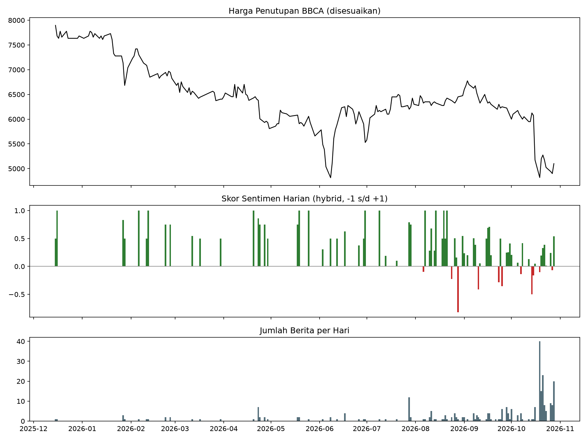
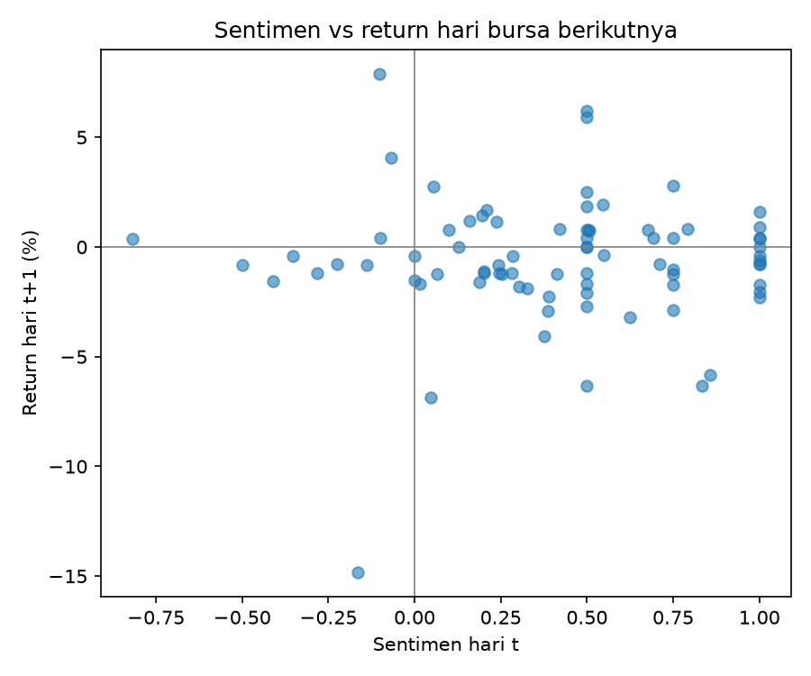

# Analisis Sentimen Berita vs Return Saham BBCA

Apakah sentimen judul berita finansial berbahasa Indonesia berhubungan dengan return saham BBCA (Bank Central Asia)? Proyek ini membangun pipeline lengkap: pengumpulan berita, pembersihan teks, skor sentimen NLP, penggabungan dengan harga saham, dan uji statistik.

## Ringkasan Temuan

- **Tidak ditemukan bukti hubungan** antara sentimen berita dan return BBCA pada lag 0-3 hari bursa (|r| ≤ 0,08; semua p > 0,5; n ≈ 80 hari). Ini berarti tidak ada bukti, bukan terbukti tidak ada: dengan n sebesar ini, uji hanya sensitif untuk korelasi sekitar 0,3 ke atas.
- **Model sentimen umum gagal pada berita finansial.** IndoRoBERTa hanya mencapai 30% akurasi pada judul berlabel manual (96% prediksinya "netral"). Pendekatan hybrid (lexicon finansial + zero-shot) mencapai 78%, tetapi angka ini optimistis (lihat Keterbatasan).
- **Sentimen harian cenderung positif sepanjang periode walau harga turun ±36%.** Pemberitaan BBCA bernada positif secara struktural (laba, dividen, buyback).
- **Pemberitaan bersifat reaktif.** Lonjakan jumlah berita terjadi setelah penurunan harga tajam pada Oktober 2026, bukan sebelumnya.




## Data

- 287 judul berita dari Google News RSS, 15 Des 2025 - 28 Okt 2026 (hanya judul, tanggal, sumber, dan link; bukan isi artikel)
- Harga BBCA.JK dari yfinance (disesuaikan dividen dan stock split)
- 206 hari bursa, 81 di antaranya punya berita

## Metodologi

1. **Pengumpulan**: RSS Google News dengan beberapa kata kunci, digabung antar-run dan dibuang duplikatnya.
2. **Pembersihan**: filter relevansi (BBCA/BCA), buang akhiran nama media, buang duplikat persis dan duplikat mirip (kemiripan judul), buang halaman statis.
3. **Skor sentimen**: lexicon finansial Indonesia + klasifikasi zero-shot (mDeBERTa-v3 XNLI). Hybrid: pakai lexicon bila ada kata kunci, selain itu zero-shot.
4. **Penanganan bias waktu**: berita terbit setelah 16:00 WIB, akhir pekan, atau hari libur dipetakan ke hari bursa berikutnya agar tidak terjadi lookahead bias.
5. **Uji**: korelasi Spearman antara sentimen hari t dan return hari t+k (k = 0 sampai 3), uji tanpa klaster buyback Oktober, dan uji ketahanan berdasarkan jumlah berita per hari.

## Hasil

| Uji | r | p |
|---|---|---|
| Lag 0 (sama hari) | -0,016 | 0,89 |
| Lag 1 | +0,010 | 0,93 |
| Lag 2 | +0,037 | 0,75 |
| Lag 3 | +0,074 | 0,52 |
| Tanpa klaster 19-28 Okt, lag 1 | +0,060 | 0,62 |

Subset hari dengan ≥3 dan ≥5 berita menunjukkan korelasi negatif (r = -0,17 dan -0,39), tetapi tidak signifikan (p = 0,41 dan 0,17) dengan n sangat kecil (25 dan 14 hari), sehingga tidak ditafsirkan.

## Validasi Model

Diukur pada 60 judul yang saya label sendiri dari sudut pandang investor BBCA:

| Metode | Akurasi | Macro-F1 |
|---|---|---|
| IndoRoBERTa (baseline) | 30% | 0,22 |
| Zero-shot | 65% | 0,67 |
| Lexicon | 75% | 0,73 |
| Hybrid | 78% | 0,73 |

Catatan: 60 judul ini juga dipakai menyusun lexicon, jadi akurasinya optimistis. Judul clickbait ("Nasib Saham BBCA Berubah Drastis") tidak memuat arah sentimen dan tidak bisa ditebak dari judul saja.

## Keterbatasan

- Sampel kecil dan tidak merata; sebagian besar hari hanya memuat 1-2 judul, sehingga skor harian berisik.
- Hanya judul, bukan isi artikel.
- Lexicon disusun dari data yang sama dengan evaluasinya (belum ada data uji terpisah).
- Banyak uji dijalankan (4 lag, beberapa subset); satu hasil signifikan di antaranya belum meyakinkan tanpa koreksi.
- Satu emiten, satu periode pasar turun.
- Korelasi bukan kausalitas. **Bukan rekomendasi investasi.**

## Cara Menjalankan

```bash
python -m venv venv
venv\Scripts\activate        # Mac/Linux: source venv/bin/activate
pip install -r requirements.txt
python src/collect.py
python src/clean.py
python src/sentiment_v2.py
python src/rescore.py
python src/aggregate.py
python src/analyze.py
python src/plot.py
```

## Rencana Pengembangan

- Sampel uji terpisah untuk validasi lexicon
- Pengumpulan harian otomatis (GitHub Actions) agar data bertambah
- Tambah emiten (BBRI, BMRI, TLKM) dan bandingkan
- Event study pada pengumuman buyback Oktober 2026